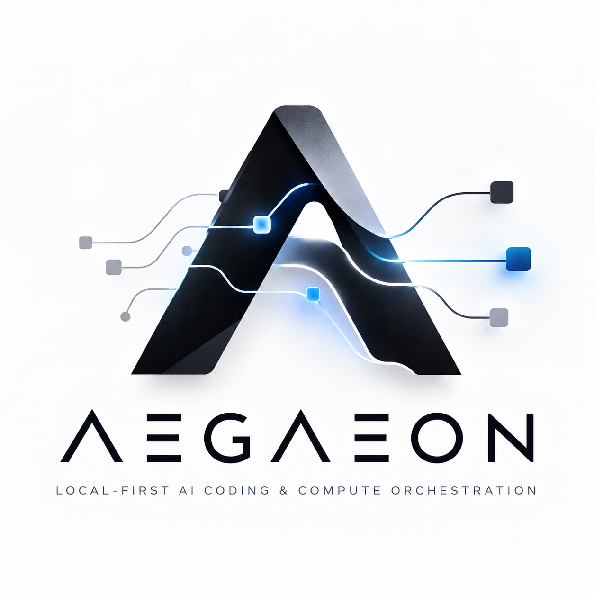
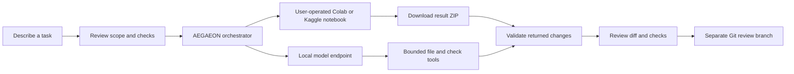
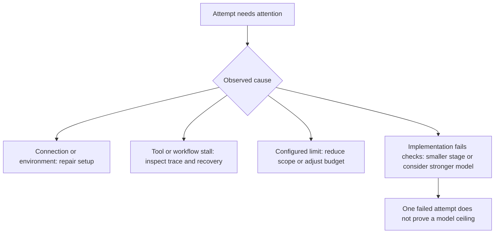

<div align="center">
  
  <h1>AEGAEON · v2.0</h1>
  <p><strong>Your project. Your model. Your compute.</strong></p>
  <p>Local-first AI coding and compute orchestration for modest hardware.</p>
</div>

## What is AEGAEON?

AEGAEON is a lightweight coding workspace that helps an AI model work on your
project. You describe a task, choose which files it may change and which tests
to run, then review the proposed code and its check results.

The model writes and reasons about code. AEGAEON manages project context, file
tools, task state, execution limits, checks, notebook transfers and review branches.
Its capabilities depend on both the connected model and the workflow. It does
not train a model, add intelligence to one, or guarantee complete apps.

**Example:** ask it to fix a price calculation. AEGAEON packages the relevant
source, lets the model inspect and edit permitted files, runs approved tests,
and presents the diff for review. Your canonical project is not automatically merged.

## How it works



Your PC can manage projects without running the model. A cloud notebook can
perform inference and return a result ZIP; it is not an unattended cloud fleet.

## Choose your workflow

| Workflow | Runs where | What you need |
| --- | --- | --- |
| Offline demo | Your PC | Python and Git; model decisions are simulated |
| Local coding | Your PC | Compatible running model endpoint and enough memory |
| Notebook worker | Colab/Kaggle | User-operated runtime, app ZIP and exported task |

The app uses Python's standard library and Git. It has no third-party Python
runtime dependencies. Model inference has separate requirements.

## Start here

1. On Windows, use **Install-AEGAEON-v2.0.bat**, supplied beside the source ZIP.
2. Open the welcome guide and try the clearly labelled offline demo.
3. Open an existing committed Git project, describe one small task, and review
   its file scope and check commands before execution.
4. Connect your model in **Model settings**, or export a task for the included notebooks.
5. Inspect changes and checks before creating or merging a review branch.

Manual source launch:

```powershell
python -m aegaeon_lite serve --demo
```

Open the loopback URL printed by the launcher. The Python package/CLI retains
the compatible name `aegaeon_lite`; the product release is AEGAEON v2.0.

## Model manager

Compare detected RAM/GPU memory, estimated fit, download size and official model
sources. The initial pinned Hugging Face catalog includes Qwen2.5-Coder
1.5B/3B/7B Q4_K_M and Qwen3 1.7B Q8_0. Downloads require confirmation and include
progress, cancellation and SHA-256 verification.

Weights alone do not run inference. Install/start a compatible official runtime
separately, then configure its endpoint. The manager provides a verified CPU
launch command. Native thinking can be requested for supported models/runtimes;
it is off by default and consumes output budget. Hardware fit is an estimate,
not a model-quality or runtime-compatibility guarantee.

## Features

- Local workspace with dark, light and system themes.
- Scoped coding tools, source inspection, safe file creation and hashed edits.
- Task plans, sequential workers, retries and accepted checkpoints.
- Separate worker and local acceptance checks, plus protected existing tests.
- Colab/Kaggle task export, result validation and Git review branches.
- Portable checkpoints and recovery.
- Model downloads, hardware-fit advice and native-thinking settings.
- Evidence-based failure guidance and bounded recovery from stalled actions.

## Evidence, not a promise

The previous functional build passed **150 automated tests**. Real Colab tests
used Qwen2.5-Coder-7B-Instruct (7.61B parameters), Q4_K_M, on a free T4.

| Final small task | Observed result |
| --- | --- |
| Create utility module | 8 tests passed |
| Repair two cooperating files | 6 tests passed |
| Answer a question across three files | Correct answer; source unchanged |
| Earlier advanced expense tracker | Partial build; 13 checks passed, 18 failed |

These are small, single-trial fixtures—not a broad capability score. Intermediate
failures and limitations are preserved in [MODEL-SCOPE-RESULTS.md](MODEL-SCOPE-RESULTS.md).




## Current boundaries

- New project-folder creation inside the UI remains unfinished; open an existing committed Git folder.
- Arbitrary app generation and automatic staged construction are not established.
- Kaggle live operation, broad framework quality and fresh-PC prerequisite installation remain unverified.
- The manager does not provide arbitrary HF search, private/gated models, other download providers or automatic runtime installation.
- Commands execute in copied directories, which are not OS sandboxes. Review commands and returned code.
- Free cloud availability varies. Download checkpoints; temporary notebook storage can disappear.

## Documentation

[Troubleshooting](TROUBLESHOOTING.md) · [Model-scope results](MODEL-SCOPE-RESULTS.md) · [License](LICENSE)

## License

AEGAEON is distributed under the [Community Non-Commercial License v1.0](LICENSE),
copyright © 2026 Cyanex. Non-commercial use is permitted subject to its terms.
Commercial use requires prior written authorization or a separate commercial
license from Cyanex. See the full license for conditions and contact details.
Third-party models, runtimes and other components retain their own licenses.
